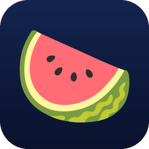
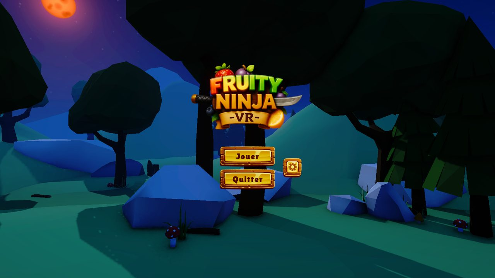
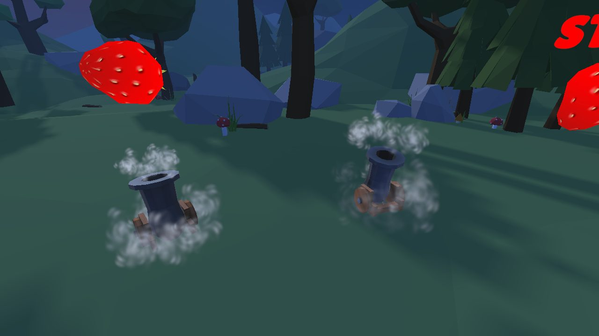
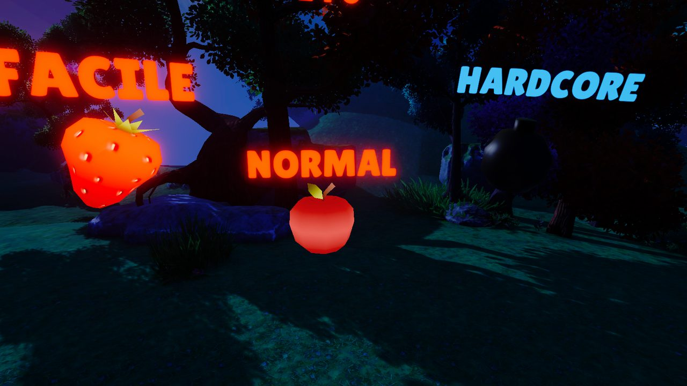
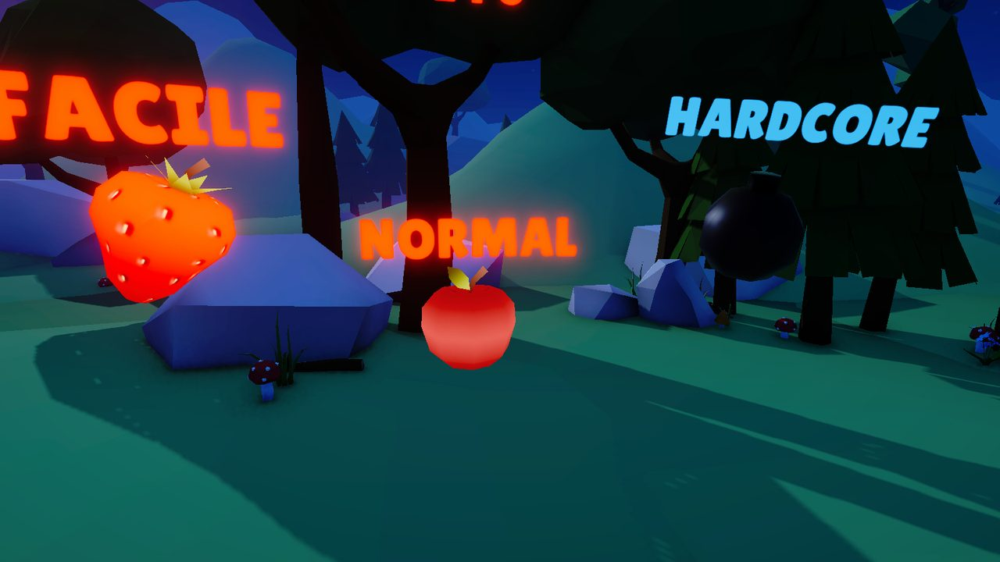
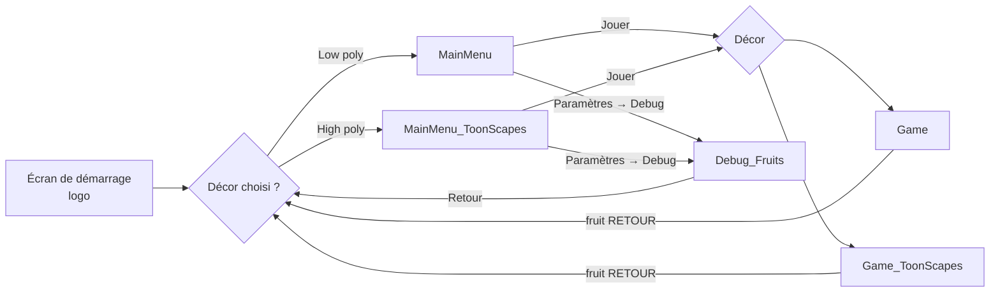
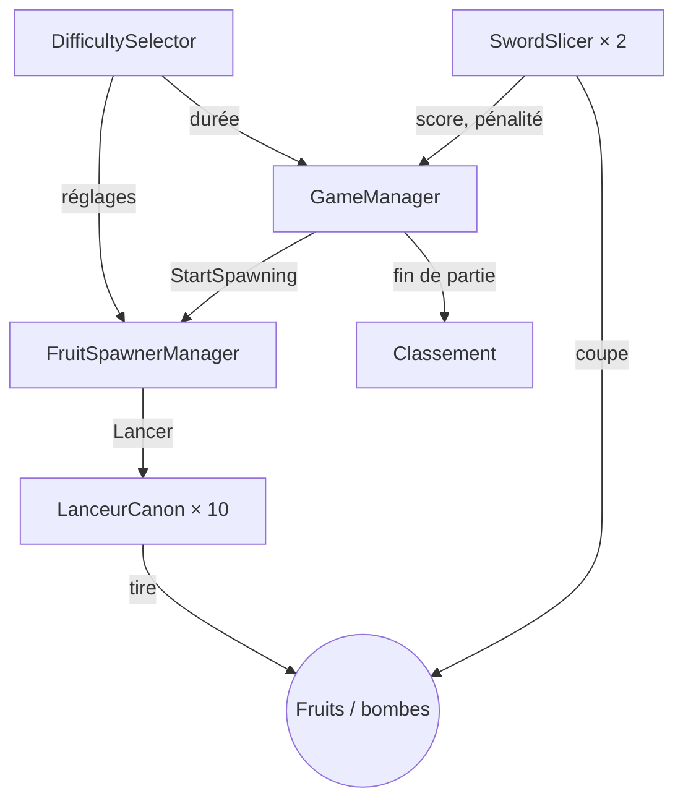

<div align="center">



# Fruity Ninja VR

**Un Fruit Ninja en réalité virtuelle, de nuit, au sabre, pour PC VR et Meta Quest.**




</div>

> [!NOTE]
> Projet pédagogique réalisé dans le cadre du **Mini projet VR – Part 1** (EFREI, I3 IRV, ST2VAAS).
> Il reprend le Fruit Ninja VR du S7 et le rend **organisé, documenté et déployable sur deux plateformes**.
> Le suivi exact des consignes du TP est dans [`docs/tp/rendu-part1.md`](docs/tp/rendu-part1.md).

> [!TIP]
> **Télécharger le jeu** : chaque partie du mini projet a sa release avec l'installeur Windows PCVR (ou le ZIP) et l'APK Meta Quest.
> Part 1 : [releases/tag/part1](https://github.com/LeBN/FruitNinja_XR/releases/tag/part1)

---

## Sommaire

- [Le jeu en 30 secondes](#le-jeu-en-30-secondes)
- [Fonctionnalités](#fonctionnalités)
- [Démarrage rapide](#démarrage-rapide)
- [Comment jouer](#comment-jouer)
- [Deux plateformes, deux décors](#deux-plateformes-deux-décors)
- [L'architecture en un coup d'œil](#larchitecture-en-un-coup-dœil)
- [Organisation du dépôt](#organisation-du-dépôt)
- [Documentation détaillée](#documentation-détaillée)
- [Crédits et licences](#crédits-et-licences)
- [Utilisation de l'IA](#utilisation-de-lia)

---

## Le jeu en 30 secondes

Tu es dans une clairière, la nuit, sous une lune rouge, un sabre dans chaque main.

1. Dans le **menu principal**, tu vises **Jouer** avec le rayon de la manette.
2. Dans la clairière, tu **coupes un fruit pour choisir la difficulté** : la fraise (Facile), la pomme (Normal) ou la bombe (Hardcore).
3. Un fruit **START** apparaît à ta droite : tu le coupes, « **Prêt ?** » s'affiche, un reflet parcourt tes lames, les manettes vibrent… c'est parti.
4. Des **canons cartoon** surgissent du sol dans un nuage de fumée et tirent des fruits vers le ciel. Tu les coupes en deux, en évitant les **bombes**.
5. À la fin du chrono, ton score rejoint le **classement** gravé sur une planche en bois à ta droite.

<div align="center">


</div>

---

## Fonctionnalités

| Domaine | Ce qui est en place | Pour aller plus loin |
|---|---|---|
| **Gameplay** | 3 difficultés (durée 90 / 60 / 45 s, cadence, part de bombes), fruits, pomme d'or, bombes (-3 points), score, classement des 20 meilleurs scores qui défile tout seul | [Gameplay](docs/02-gameplay.md) |
| **Découpe** | Coupe réelle des maillages en deux moitiés physiques (EzySlice) au point de contact de la lame | [Gameplay](docs/02-gameplay.md#la-découpe) |
| **VR** | OpenXR + Meta XR, deux sabres, rayons dans les menus seulement, vibrations, rotation instantanée ou continue, zone de jeu de 7 m, placement des fruits selon ta taille | [VR et interactions](docs/03-vr-et-interactions.md) |
| **Rendu** | URP, nuit bleue et lune rouge, éclairage précalculé (indirect + AO), occlusion culling, shaders maison | [Rendu et shaders](docs/04-rendu-et-shaders.md) |
| **Effets** | Jus et explosion en **deux versions** (PCVR complète, Quest allégée), choisies automatiquement | [Effets multiplateforme](docs/05-effets-multiplateforme.md) |
| **Audio** | Musiques, ambiance de forêt de nuit, **tous les effets en 3D** à l'endroit où ils se produisent | [Audio](docs/06-audio.md) |
| **Interface** | Menu en bois accordé au logo, police Lilita One, menu Paramètres (volumes, vibrations, décor, debug) | [Interface](docs/07-interface.md) |
| **Déploiement** | Build Windows PCVR + APK Quest, écran de démarrage et icône personnalisés | [Builds et déploiement](docs/08-builds-et-deploiement.md) |

---

## Démarrage rapide

### Prérequis

| Outil | Version | Remarque |
|---|---|---|
| Unity | **6000.4.6f1** | avec les modules *Windows Build Support* et *Android Build Support* (SDK, NDK, OpenJDK) |
| Casque | Meta Quest 3 (ou 2 / Pro) | mode développeur activé pour installer l'APK |
| PC VR | runtime OpenXR actif (Meta Quest Link ou SteamVR) | pour jouer en PCVR ou dans l'éditeur |

### Ouvrir le projet

```bash
git clone https://github.com/LeBN/FruitNinja_XR.git
```

Puis, dans **Unity Hub** : *Add project from disk* → le dossier cloné → Unity 6000.4.6f1.

> [!IMPORTANT]
> Le décor détaillé (**ToonScapes – Spring Isles**) est un pack acheté qui **n'est pas versionné** (1,8 Go et licence non redistribuable).
> Sans lui, le jeu fonctionne entièrement avec le décor d'origine low poly ; seules les scènes `*_ToonScapes` auront des objets manquants.
> Pour les utiliser, importe le pack dans `Assets/ToonScapes/`. Voir [Assets et licences](docs/09-assets-et-licences.md).

### Jouer dans l'éditeur

1. Branche le casque (Link) et vérifie que le runtime OpenXR est actif.
2. Ouvre `Assets/FruitNinja/Scenes/MainMenu.unity` et appuie sur **Play**.

### Construire les versions

| Version | Où | Détails |
|---|---|---|
| Windows PCVR | `File > Build Profiles > Windows` | [Builds et déploiement](docs/08-builds-et-deploiement.md#build-windows-pcvr) |
| Meta Quest (APK) | `File > Build Profiles > Android` | [Builds et déploiement](docs/08-builds-et-deploiement.md#build-android-pour-meta-quest) |

---

## Comment jouer

| Action | Contrôle |
|---|---|
| Cliquer dans un menu | viser avec le **rayon** de la manette + **gâchette** |
| Couper | bouger le **sabre** à travers le fruit (il suffit de le traverser) |
| Choisir la difficulté | couper la **fraise** (Facile), la **pomme** (Normal) ou la **bombe** (Hardcore) |
| Lancer la partie | couper le fruit **START** |
| Revenir au menu | couper la **banane « RETOUR »**, à gauche |
| Se déplacer / tourner | joysticks (déplacement continu et rotation) |

> [!TIP]
> Le son du sabre change selon la vitesse **au bout de la lame** : un geste lent fait un « whoosh » grave, un geste rapide un sifflement aigu.

---

## Deux plateformes, deux décors

Le même projet produit deux versions. Ce qui change est décidé **automatiquement** selon la plateforme du build :

| | Windows PCVR | Meta Quest autonome |
|---|---|---|
| Calcul du rendu | carte graphique du PC | puce mobile du casque |
| Effets de particules | version **PCVR** complète | version **Quest** allégée |
| Décor par défaut | **High poly** (ToonScapes) | **Low poly** (d'origine) |
| Rendu stéréo | Single Pass Instanced | Single Pass Instanced (Multiview) |

Le décor se change dans **Paramètres → Décor détaillé**.

<div align="center">


<br><em>À gauche le décor low poly (léger, par défaut sur Quest), à droite le décor ToonScapes (par défaut sur PC).</em>
</div>

---

## L'architecture en un coup d'œil



Dans la scène de jeu, quelques composants font tout le travail :



Chaque bloc est expliqué dans [Architecture](docs/01-architecture.md).

---

## Organisation du dépôt

```text
Assets/
├── FruitNinja/            ← tout ce qui est propre au jeu (noms en français, rangés par type)
│   ├── Scenes/            MainMenu, Game, Debug_Fruits (+ copies ToonScapes, données d'éclairage)
│   ├── Scripts/           le code C#, rangé par domaine :
│   │   ├── Jeu/           partie, lanceurs, difficultés, classement, apparition du Start
│   │   ├── Sabres/        découpe, sons de sabre, reflet des lames
│   │   ├── VR/            zone de 7 m, rotation, pointeurs, vibrations
│   │   ├── Interface/     menus, paramètres, planche du classement
│   │   ├── Reglages/      paramètres sauvegardés, choix du décor, plateforme
│   │   ├── Audio/         sons 3D, musique
│   │   ├── Rendu/         reflet de l'or
│   │   ├── Debug/         galerie de debug
│   │   └── Editor/        outils de l'éditeur (builds)
│   ├── Prefabs/           Fruits, Bombes, FX, XR, Environnement, Debug
│   ├── Resources/         fruit de démarrage (chargé par son nom)
│   ├── Materiaux/         matériaux du jeu (+ FX, copies de nuit ToonScapes)
│   ├── Shaders/           shaders URP maison (reflet des lames, fantôme, particules, or)
│   ├── Textures/          ciel, canon, effets, cubemaps de reflet
│   ├── Modeles/           canon cartoon
│   ├── Interface/         Images/ (bois, boutons, logo, icônes, démarrage) et Polices/ (Lilita One)
│   ├── Sons/              Musiques, Ambiances, Effets
│   └── Reglages/          réglages d'éclairage précalculé
├── ThirdParty/            ← packs tiers versionnés, sans modification (fruits, nature, sabre, EzySlice…)
└── ToonScapes/            ← décor high poly, non versionné (licence), à importer soi-même
docs/                      ← la documentation que tu lis
Installeur/                ← script de l'installeur Windows (Inno Setup)
```

Les autres dossiers à la racine d'`Assets` (`Samples`, `TextMesh Pro`, `XR`, `XRI`, `Oculus`, `Settings`…) sont gérés par Unity et les packages : ils doivent rester à leur place.

---

## Documentation détaillée

| # | Document | Tu y apprendras… |
|---|---|---|
| 1 | [Architecture](docs/01-architecture.md) | comment les scènes s'enchaînent et qui fait quoi |
| 2 | [Gameplay](docs/02-gameplay.md) | difficultés, canons, découpe, score, classement |
| 3 | [VR et interactions](docs/03-vr-et-interactions.md) | OpenXR, rig XR, rayons, vibrations, sons de sabre |
| 4 | [Rendu et shaders](docs/04-rendu-et-shaders.md) | ambiance de nuit, shaders maison, éclairage précalculé |
| 5 | [Effets multiplateforme](docs/05-effets-multiplateforme.md) | pourquoi et comment un effet existe en version PCVR et Quest |
| 6 | [Audio](docs/06-audio.md) | musiques, sons 3D, réglages de volume |
| 7 | [Interface](docs/07-interface.md) | menus, paramètres, police, classement, écran de démarrage |
| 8 | [Builds et déploiement](docs/08-builds-et-deploiement.md) | générer, installer et analyser les builds |
| 9 | [Assets et licences](docs/09-assets-et-licences.md) | d'où vient chaque ressource et ce qui est versionné |
| 10 | [Utilisation de l'IA](docs/10-utilisation-ia.md) | ce que l'IA a produit, comment, et ses limites |
| TP | [Rendu du TP – Part 1](docs/tp/rendu-part1.md) | les Tasks 1 à 5 du sujet, point par point |

---

## Crédits et licences

- **Projet** : [LeBN](https://github.com/LeBN), EFREI (I3 IRV), à partir du Fruit Ninja VR du S7.
- **Canon** : « [Stylized Canon](https://sketchfab.com/3d-models/stylized-canon-3f7b731c25d9456d98e28bf2612f818b) » par [Anggo Ari Wibowo](https://sketchfab.com/anggoariwibowo), licence [CC BY 4.0](https://creativecommons.org/licenses/by/4.0/) (modifié).
- **Interface en bois** : vecteur Premium [Magnific n° 423087565](https://www.magnific.com/fr/vecteurs-premium/collection-elements-interface-utilisateur-jeu-bois-pour-conception-interface_423087565.htm) — Image de [abusayem9024](https://www.magnific.com/fr/auteur/abusayem9024) sur Magnific.
- **Autres modèles, sons et décors** : packs listés dans [Assets et licences](docs/09-assets-et-licences.md).
- **Police** : Lilita One (SIL Open Font License 1.1).
- **Icône** : émoji pastèque de Noto Emoji (Google).

## Utilisation de l'IA

Le logo a été généré par IA, et une grande partie du code et de l'automatisation a été produite avec **Claude (Anthropic) dans Claude Code**, sous ma direction et validée par des tests dans le casque.
Le détail (ce qui a été généré, comment, les erreurs corrigées) est dans [Utilisation de l'IA](docs/10-utilisation-ia.md).
