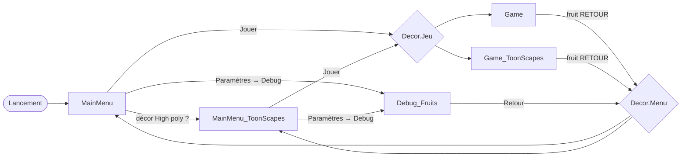
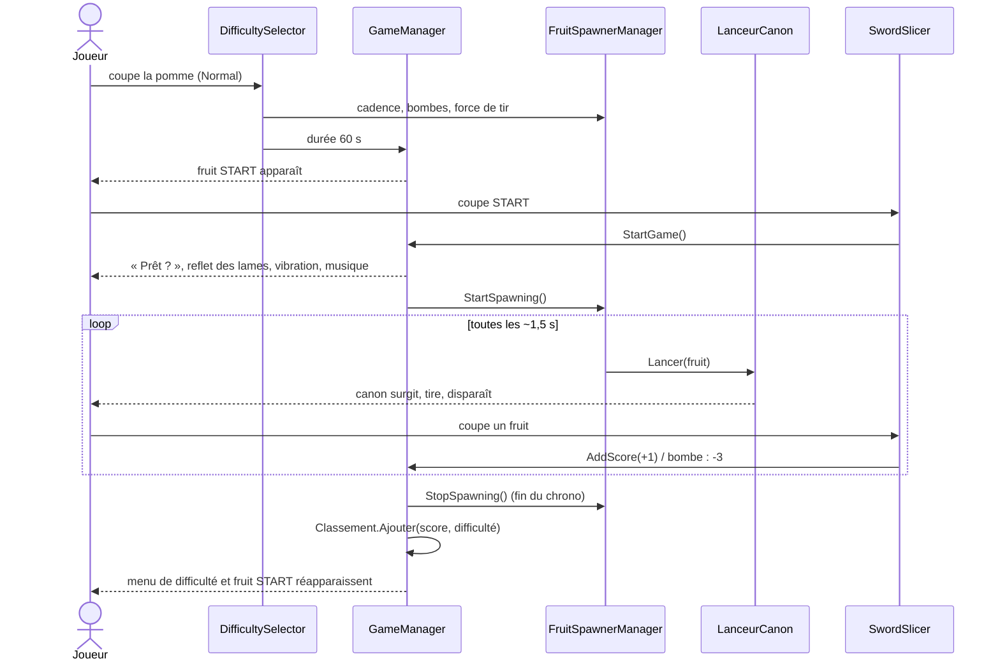

# 1. Architecture

> **En bref** : le jeu tient en **5 scènes** et une trentaine de petits scripts, chacun avec **un seul rôle**.
> Ce document explique comment les scènes s'enchaînent, comment une scène est rangée, et quel script fait quoi.

[← Retour au README](../README.md) · Suivant : [Gameplay →](02-gameplay.md)

---

## Sommaire

- [Les scènes et leur enchaînement](#les-scènes-et-leur-enchaînement)
- [Le choix du décor : `Decor.cs`](#le-choix-du-décor--decorcs)
- [Comment une scène est rangée](#comment-une-scène-est-rangée)
- [Carte des scripts](#carte-des-scripts)
- [Le cycle de vie d'une partie](#le-cycle-de-vie-dune-partie)
- [Où sont stockées les données ?](#où-sont-stockées-les-données-)

---

## Les scènes et leur enchaînement

| Index build | Scène | Rôle |
|---|---|---|
| 0 | `MainMenu` | menu principal, décor **low poly** (scène de démarrage) |
| 1 | `Game` | la partie, décor **low poly** |
| 2 | `Debug_Fruits` | galerie de debug : tous les objets du jeu et un panneau pour tester chaque fonctionnalité, ouverte depuis les Paramètres |
| 3 | `MainMenu_ToonScapes` | menu principal, décor **high poly** |
| 4 | `Game_ToonScapes` | la partie, décor **high poly** |



> [!NOTE]
> **Pourquoi des copies de scènes plutôt qu'un interrupteur dans une seule scène ?**
> Le décor ToonScapes contient environ 750 objets et ses propres données d'éclairage précalculé.
> Le mettre dans des scènes séparées permet au Quest de **ne jamais charger** ce décor quand il est désactivé : la mémoire et le temps de chargement restent ceux du décor léger.

---

## Le choix du décor : `Decor.cs`

Toute la navigation passe par une petite classe statique qui répond à une seule question : *« quelle scène charger ? »*

```csharp
public static string Menu => Parametres.HighPoly && Disponible(MenuHighPoly) ? MenuHighPoly : MenuLowPoly;
public static string Jeu  => Parametres.HighPoly && Disponible(JeuHighPoly)  ? JeuHighPoly  : JeuLowPoly;
```

- `Parametres.HighPoly` est l'option **Décor détaillé** des Paramètres. Elle vaut `true` par défaut sur PC et `false` sur Quest.
- `Disponible(...)` vérifie que la scène est bien dans le build. Si elle n'y est pas, on retombe sur le décor d'origine au lieu de planter.
- Au lancement d'un build, `MainMenuManager` redirige vers le bon menu. Dans l'éditeur, cette redirection est désactivée pour que tu puisses ouvrir et tester n'importe quelle scène directement.

> [!TIP]
> **À retenir** : centraliser une décision (ici « quelle scène ? ») dans **un seul endroit** évite que chaque bouton ait sa propre logique, et donc ses propres bugs.

---

## Comment une scène est rangée

Toutes les scènes suivent la même convention de hiérarchie (celle de mes projets du S8) :

```text
--Player--            le rig XR (casque, manettes, sabres), le XR Interaction Manager
--Managers--          GameManager, DifficultySelector, FruitSpawnerManager…
--Lights&Effects--    lumière de lune, volume de post-traitement, sonde de reflets
--Audio--             musiques et ambiance
--Environnement--     décor (arbres, rochers, sol…) — statique, éclairage précalculé
--Interactions--      menu de difficulté, fruit de départ, lanceurs (canons)
--UI--                HUD, classement, EventSystem
```

Les séparateurs `--Nom--` sont des objets vides : ils ne font rien en jeu, mais on retrouve tout de suite où se trouve chaque chose.

---

## Carte des scripts

Les scripts sont dans `Assets/FruitNinja/Scripts/`. Ils sont regroupés ici par rôle.

### Déroulé de la partie

| Script | Rôle |
|---|---|
| `GameManager` | score, chrono, séquence « Prêt ? », début et fin de partie, fruit de départ |
| `DifficultySelector` | applique les réglages de la difficulté coupée (durée, cadence, bombes…) |
| `DifficultyFruit` | un fruit de difficulté : fantôme quand il est choisi, étiquette, durée affichée |
| `FruitRetour` | la banane « RETOUR » : coupée → retour au menu |
| `PlacementSelonJoueur` / `HauteurJoueur` | placent les fruits à hauteur de sabre selon ta taille |
| `Classement` / `AffichageClassement` | sauvegarde et affichage des 20 meilleurs scores (défilement automatique) |
| `ApparitionMagique` | apparition « éclair magique » du fruit START |
| `MasquerPointeurs` | aucun pointeur en partie (rayon des menus, téléportation, poke) |
| `GalerieDebug`, `SocleDebug`, `BoutonDebug`, `CurseurDebug` | galerie et panneau de la scène de debug |

### Lancer et couper

| Script | Rôle |
|---|---|
| `FruitSpawnerManager` | vagues de fruits : quoi lancer, d'où, à quelle cadence |
| `LanceurCanon` | le canon d'un lanceur : apparition « boing », tir, fumée, disparition |
| `SwordSlicer` | détecte la coupe, coupe le maillage, score, pénalité, effets |
| `FruitRotation` / `VelocityEstimator` | rotation des fruits, estimation de vitesse (hérités du S7) |

### Sensations (effets, son, vibrations)

| Script | Rôle |
|---|---|
| `PlatformFx` | choisit la version PCVR ou Quest d'un effet |
| `PenaltyPopup` | le « -3 » rouge qui flotte au-dessus d'une bombe |
| `BladeShine` | le reflet lumineux qui parcourt la lame au départ |
| `SonSpatial` | joue un son **en 3D** à l'endroit où il se produit |
| `SwordSwingSound` | son de fendage d'air selon la vitesse du bout de la lame |
| `GameMusicManager` | stinger de départ puis musique de combat, fondu en fin de partie |
| `Vibrations` | vibrations des deux manettes (XRI) |

### Menus et réglages

| Script | Rôle |
|---|---|
| `MainMenuManager` | boutons Jouer / Quitter / Paramètres, redirection vers le bon décor |
| `Parametres` | volumes, vibrations, décor : lus et sauvegardés dans les PlayerPrefs |
| `ReglageVolume`, `ReglageVibrations`, `ReglageDecor` | les contrôles du panneau Paramètres |
| `VolumeMusique` | applique le volume « Musique » à une source audio |
| `Decor` | quelle scène de menu ou de jeu charger |
| `RetourMenu` | bouton Retour de la scène de debug |
| `RotationJoueur`, `ReglageRotation` | rotation instantanée ou continue, appliquée aux manettes |
| `LimiteZone` | garde le joueur dans un cercle de 7 m autour de son point de départ |
| `CubemapOr` | donne au shader de l'or le reflet précalculé du décor de la scène |

---

## Le cycle de vie d'une partie



---

## Où sont stockées les données ?

Tout est dans les **PlayerPrefs** de Unity (le registre sous Windows, un fichier de préférences sous Android) :

| Clé | Contenu |
|---|---|
| `param_volume_general`, `param_volume_musique`, `param_volume_effets` | volumes (0 à 1) |
| `param_vibrations`, `param_high_poly`, `param_rotation_continue` | options Oui/Non |
| `classement_scores` | le classement, sérialisé en **JSON** (`score`, `difficulte`, `date`) |
| `HighScore` | meilleur score (hérité du S7) |

> [!TIP]
> Le classement est stocké en JSON grâce à `JsonUtility`. C'est simple, lisible, et ça répond à la « sauvegarde JSON » demandée dans le TP sans fichier supplémentaire.

---

[← Retour au README](../README.md) · Suivant : [Gameplay →](02-gameplay.md)
