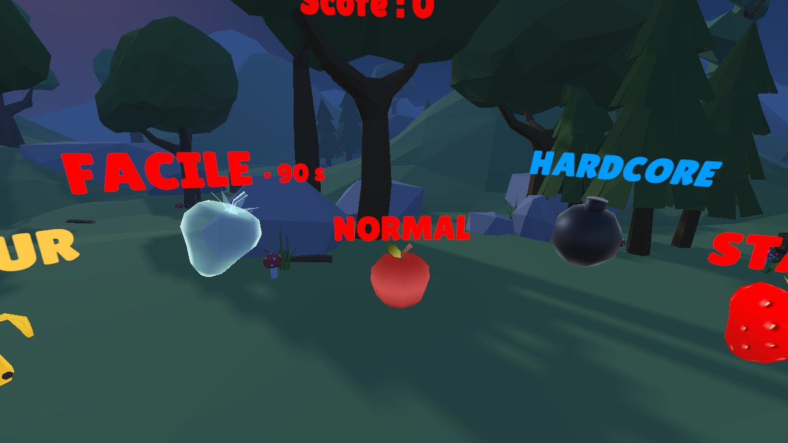
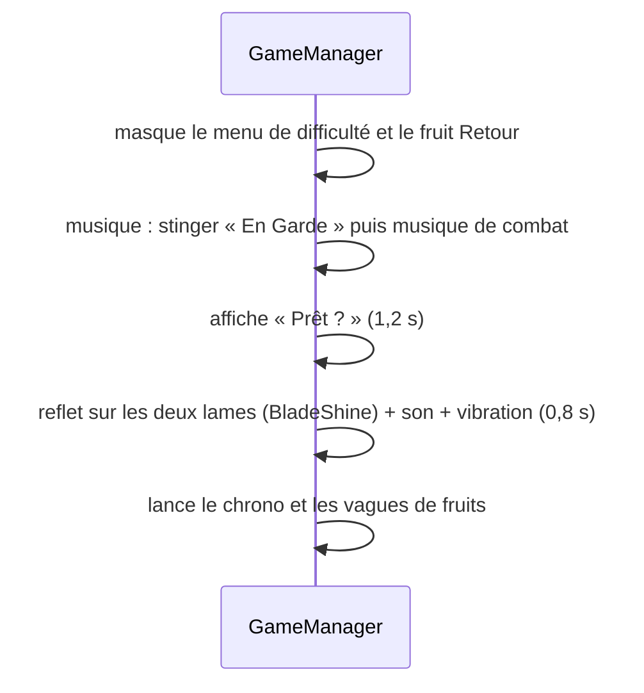
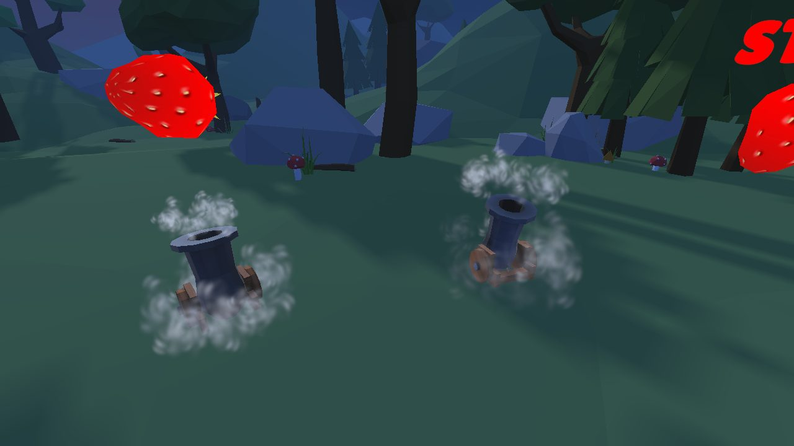
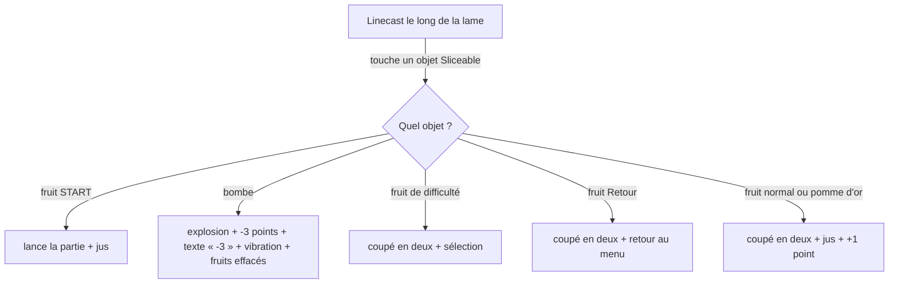
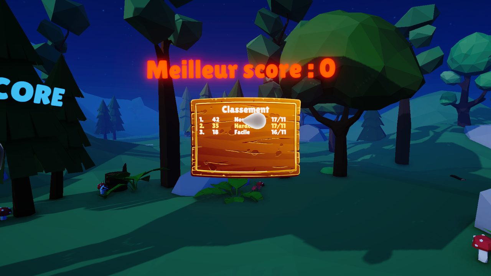

# 2. Gameplay

> **En bref** : tu choisis une difficulté en coupant un fruit, des canons tirent des fruits et des bombes vers le ciel, tu les coupes avant qu'ils retombent.
> Ce document explique chaque mécanique et **où la régler**.

[← Architecture](01-architecture.md) · [README](../README.md) · Suivant : [VR et interactions →](03-vr-et-interactions.md)

---

## Sommaire

- [Choisir la difficulté en coupant un fruit](#choisir-la-difficulté-en-coupant-un-fruit)
- [Les trois difficultés](#les-trois-difficultés)
- [Le départ : fruit START, « Prêt ? » et reflet des lames](#le-départ--fruit-start--prêt--et-reflet-des-lames)
- [Les canons lanceurs](#les-canons-lanceurs)
- [La découpe](#la-découpe)
- [Score, bombes et pomme d'or](#score-bombes-et-pomme-dor)
- [Des fruits à ta hauteur](#des-fruits-à-ta-hauteur)
- [Le classement](#le-classement)
- [Le fruit Retour](#le-fruit-retour)

---

## Choisir la difficulté en coupant un fruit



Plutôt qu'un menu à boutons, la difficulté se choisit **avec le geste du jeu** : on coupe le fruit qui la représente.

1. La **fraise** = Facile, la **pomme** = Normal, la **bombe** = Hardcore.
2. Le fruit coupé tombe en deux morceaux, puis laisse un **fantôme** translucide à sa place : tu vois ce que tu as choisi.
3. Si tu changes d'avis, coupe un autre fruit : l'ancien réapparaît, le nouveau devient fantôme.
4. La **durée** de la difficulté choisie s'affiche à côté de son nom (« FACILE · 90 s », sur une seule ligne grâce à des espaces insécables) et sur le chrono.
5. Chaque étiquette a sa couleur : **Facile vert**, **Normal orange**, **Hardcore rouge**, **Start cyan**, Retour jaune.

Côté code :

- `DifficultyFruit` (sur chaque fruit) sait se montrer, se cacher ou passer en fantôme, et affiche sa durée.
- `DifficultySelector` reçoit le choix (`Select`) et **applique les réglages** au spawner et au `GameManager`.

> [!NOTE]
> Les morceaux coupés apparaissent bien **à la place** du fruit. Ce n'était pas le cas au début : EzySlice recopiait la position *locale* du fruit sur des objets créés à la racine de la scène, et comme les fruits de difficulté sont rangés dans un parent, leurs morceaux tombaient 3,5 m derrière le joueur. `SwordSlicer` recopie maintenant la position et l'échelle **monde** (`PlaceLikeOriginal`).

---

## Les trois difficultés

Elles sont définies dans le tableau `settings` du `DifficultySelector` (modifiable dans l'inspecteur) :

| | Facile | Normal | Hardcore |
|---|---|---|---|
| Durée de la partie | 90 s | 60 s | 45 s |
| Intervalle moyen entre deux vagues | 1,9 s | 1,5 s | 1,0 s |
| Objets par vague | 1 à 2 | 1 à 3 | 2 à 4 |
| Probabilité de bombe | 8 % | 15 % | 25 % |
| Force de tir | 5,5 | 6 | 7 |

En plus de ces réglages, chaque objet lancé a **10 % de chances** d'être une pomme d'or.

---

## Le départ : fruit START, « Prêt ? » et reflet des lames

Après le choix de la difficulté, un fruit **START** apparaît à ta droite, avec une **apparition « éclair magique »** (`ApparitionMagique`) :

1. trois anneaux de lumière cyan, inclinés différemment, se resserrent sur le point d'apparition en tournant (0,65 s), pendant qu'un « whoosh » monte ;
2. à l'impact : éclair, gerbe d'étincelles (moitié moins sur Quest), « pop » élastique du fruit, carillon et petite vibration ;
3. le fruit ne peut être coupé qu'une fois apparu.

Le son est synthétisé pour l'occasion et calé sur l'animation. L'intensité lumineuse des anneaux et de l'éclair vient de leurs **matériaux** (couleurs HDR) et non des couleurs de sommets, limitées entre 0 et 1 : c'est ce qui permet au bloom de les faire briller.

Le couper appelle `GameManager.StartGame()`, qui lance une petite séquence :



C'est un petit rituel qui laisse le temps de se mettre en place et qui donne une identité au jeu.

---

## Les canons lanceurs



Dix points de lancement (`Lanceur_01` à `Lanceur_10`) sont placés devant le joueur. Sur chacun, un `LanceurCanon` contrôle un canon cartoon caché au repos.

Quand le spawner veut lancer un fruit depuis un lanceur :

1. **Apparition** : le canon surgit du sol avec une animation de **ressort** (« boing »), dans un nuage de fumée et avec un son.
2. **Tir** : après 0,22 s, le fruit part de la **bouche du canon**, avec un « pop », un petit recul et une bouffée de fumée.
3. **Disparition** : 0,5 s après le dernier tir, le canon s'écrase puis s'étire en rétrécissant, dans un dernier « pouf ».

### Comment marche l'animation « boing » ?

Pas d'Animator ni de clips : l'échelle du canon suit une **formule de ressort amorti**.

```csharp
// 0 → dépasse 1 → rebondit → se stabilise à 1
static float Ressort(float t) => 1f - Mathf.Cos(t * Mathf.PI * 2.5f) * Mathf.Exp(-5f * t);
```

- `cos(...)` fait **osciller** la valeur autour de 1 ;
- `exp(-5t)` **amortit** l'oscillation, qui s'éteint en douceur.

Pour le côté cartoon, on ajoute de l'**étirement et de l'écrasement** (*squash & stretch*) : quand l'échelle monte vite, le canon s'étire en hauteur et s'amincit ; quand elle redescend, il s'écrase et s'élargit. C'est un des 12 principes de l'animation Disney, et il ne coûte que trois lignes de code.

> [!TIP]
> Les durées (`dureeApparition`, `delaiAvantLancer`, `resteApresLancer`…) sont réglables dans l'inspecteur de chaque `LanceurCanon`.

---

## La découpe

Chaque sabre porte un `SwordSlicer`. À chaque image physique (`FixedUpdate`), il trace un **segment** entre deux points de la lame (`startSlicePoint` → `endSlicePoint`) et regarde s'il traverse un objet du calque **Sliceable**.



La coupe elle-même utilise **EzySlice** : le maillage est réellement coupé par un plan, ce qui produit deux nouveaux maillages avec une face de coupe (`crossSectionMaterial`). On leur ajoute un `Rigidbody` et une petite explosion pour les écarter.

> [!NOTE]
> Une **anti-répétition** (150 ms) évite de couper deux fois le même objet pendant le passage de la lame.

---

## Score, bombes et pomme d'or

| Objet | Effet |
|---|---|
| Fruit | **+1** point, jus à la couleur du fruit au point de contact |
| Pomme d'or | **+1** point, en or métallique pour être repérée de loin |
| Bombe | **−3** points, explosion, texte « −3 » qui flotte, vibration des deux manettes, et **tous les fruits en l'air disparaissent** |

Le score ne descend jamais sous 0. Les fruits non coupés sont détruits 1,5 s après leur tir.

> [!NOTE]
> La pomme d'or rapporte pour l'instant autant qu'un fruit normal (comportement hérité du S7). C'est une piste d'amélioration simple : un bonus de points ou de temps.

---

## Des fruits à ta hauteur

Un joueur debout de 1,85 m et un joueur assis n'ont pas les yeux à la même hauteur. Placer les fruits à une hauteur fixe, c'est forcément les mettre trop haut pour l'un ou trop bas pour l'autre. C'était le cas du fruit de départ, à 1,93 m du sol.

`HauteurJoueur` lit la hauteur des yeux (la caméra du rig XR) par rapport au sol (l'origine du rig) :

| Objet | Placement |
|---|---|
| Fruit START | 35 cm **sous tes yeux**, entre 0,9 et 1,6 m du sol |
| Menu de difficulté | 45 cm sous tes yeux, entre 0,9 et 1,5 m du sol |

Tant que le casque n'est pas suivi (premières images, casque posé), on garde la position de la scène. `PlacementSelonJoueur` attend jusqu'à 3 s que le suivi soit valide, puis réajuste à chaque réapparition du menu.

---

## Le classement



À la fin de chaque partie, `Classement.Ajouter(score, difficulté)` :

1. lit la liste sauvegardée (JSON dans les PlayerPrefs) ;
2. ajoute le nouveau score avec sa difficulté et la date ;
3. trie, garde les **20 meilleurs**, sauvegarde ;
4. prévient l'affichage, qui surligne le **dernier score en doré**.

L'affichage (`AffichageClassement`) utilise les balises `<pos=…%>` de TextMeshPro pour aligner les colonnes (rang, score, difficulté, date) sans tableau d'UI compliqué. Le bouton **Effacer scores** des Paramètres vide le classement.

**Défilement automatique** : la planche affiche environ 6 lignes. Comme il n'y a pas de rayon en partie, la liste défile toute seule dans une fenêtre masquée (`RectMask2D`) : pause en haut, descente lente, pause en bas, remontée. Après une partie, elle se place d'abord sur ton **nouveau score** (surligné en doré) pendant quelques secondes.

> [!NOTE]
> Le classement est sauvegardé dans les `PlayerPrefs` : il survit aux mises à jour du jeu (registre Windows sur PC, données de l'application sur Quest, tant que l'APK est signé avec la même clé, voir [Builds](08-builds-et-deploiement.md)).

---

## Le fruit Retour

La banane « RETOUR », à gauche du menu de difficulté, ramène au menu principal du décor choisi. Elle est **masquée pendant la partie** pour éviter de quitter par erreur d'un coup de sabre. Après la coupe, un délai de 0,7 s laisse voir les morceaux tomber avant de changer de scène.

---

[← Architecture](01-architecture.md) · [README](../README.md) · Suivant : [VR et interactions →](03-vr-et-interactions.md)
