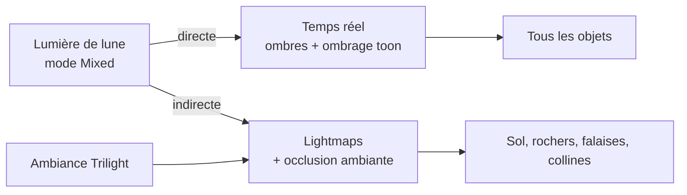
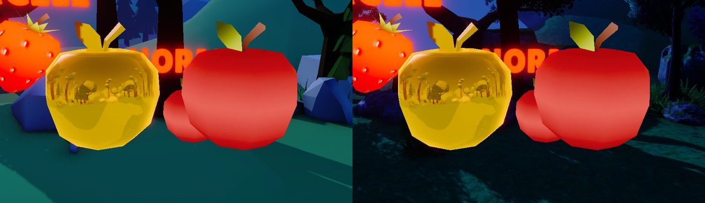

# 4. Rendu et shaders

> **En bref** : une nuit bleue sous une lune rouge, obtenue avec l'URP (Universal Render Pipeline), un post-traitement soigné, un éclairage en partie **précalculé** et quatre **shaders maison**.
> Ce document explique comment l'ambiance est construite et comment elle reste fluide sur Quest.

[← VR et interactions](03-vr-et-interactions.md) · [README](../README.md) · Suivant : [Effets multiplateforme →](05-effets-multiplateforme.md)

---

## Sommaire

- [Construire une ambiance de nuit](#construire-une-ambiance-de-nuit)
- [Le post-traitement](#le-post-traitement)
- [L'éclairage précalculé](#léclairage-précalculé)
- [L'occlusion culling](#locclusion-culling)
- [Les shaders maison](#les-shaders-maison)
- [Le décor ToonScapes (high poly)](#le-décor-toonscapes-high-poly)
- [Netteté et performance](#netteté-et-performance)

---

## Construire une ambiance de nuit

Une nuit réussie en jeu n'est pas une scène noire : c'est une scène **bleue et contrastée**, où l'on distingue les formes grâce à quelques sources bien choisies.

| Élément | Réglage | Effet |
|---|---|---|
| **Ciel** | texture générée (`Ciel_NuitEtoilee`) : dégradé bleu nuit, étoiles, lune rouge | donne la direction de la lumière et l'identité visuelle |
| **Lumière de lune** | directionnelle, bleu clair (0,62 ; 0,76 ; 1), intensité 0,9, ombres à **pleine force** | découpe les formes, ombres bien marquées |
| **Lumière d'ambiance** | *Trilight* : ciel bleu, horizon bleu moyen, sol bleu sombre (+20 % pour voir les faces à l'ombre) | les faces non éclairées restent lisibles |
| **Brouillard** | linéaire, de 8 à 85 m, **bleu nuit** (0,085 ; 0,13 ; 0,29) | le décor lointain devient une silhouette sombre sur le ciel, on sent la profondeur |
| **Lune rouge** | affichée rouge-orangé (1,0 ; 0,40 ; 0,24), comme les reflets des lames | rappel de couleur chaude au milieu du bleu |

> [!TIP]
> **À retenir** : la couleur affichée de la lune (dans le ciel) et la couleur de la lumière qu'elle émet sont **indépendantes**. Ici la lune *paraît* rouge, mais *éclaire* en bleu clair : c'est un choix artistique, pas une contrainte physique.

---

## Le post-traitement

Le profil `PostProcess_Nuit` (dans `Assets/Settings`) s'applique à toute la scène :

| Effet | Réglage | Pourquoi |
|---|---|---|
| Tonemapping | **ACES** | rendu « cinéma », noirs profonds, hautes lumières douces |
| Exposition / contraste | +1,1 / 6 | compense le côté sombre de la nuit sans délaver |
| Lift / Gamma | −0,02 / +0,06 | noirs plus profonds, tons moyens lisibles |
| Bloom | intensité 2, **seuil 1,5**, plafond 8, teinte rouge | halo autour des lames, des textes lumineux et de la lune ; les textes blancs posés sur le bois restent nets |

### Les « éclairs » du bloom sur Quest

Dans le casque uniquement, des points des arbres et des plantes ToonScapes s'illuminaient brutalement, quelle que soit l'intensité du bloom.

**Première tentative (insuffisante)** : *Stop NaN* sur la caméra et bloom plafonné (`clamp` = 8). Le halo a diminué, mais les points brillaient toujours : le pixel lui-même était déjà trop lumineux **avant** le post-traitement.

**Cause trouvée dans le shader de végétation** : son reflet secondaire calcule `normalize(vue + lumière)`. Ce vecteur s'annule quand on regarde une feuille à contre-jour, face à la lune : la normalisation d'un vecteur nul donne un pixel **invalide (NaN)**. Sur PC, il est éliminé ; sur Quest, l'image HDR est stockée dans un format compact (R11G11B10) où ce pixel devient la **valeur maximale** : un blanc éclatant, qui n'est plus « invalide » et échappe donc à Stop NaN.

**Correction à la source** : des copies de nuit des matériaux de végétation (`Materiaux/ToonScapes/Vegetation/*_Nuit`) avec le **reflet secondaire coupé**. Il était à peine visible la nuit, et le pack n'est pas modifié. Stop NaN et le plafond du bloom restent en place, par sécurité.

> [!TIP]
> **À retenir** : un `normalize()` sur un vecteur qui peut s'annuler (demi-vecteur, différence de positions) est une source classique de NaN. Sur mobile, ces NaN ne se voient pas toujours comme du noir : selon le format de l'image, ils peuvent devenir des points blancs.

---

## L'éclairage précalculé

### L'idée

Calculer la lumière **pendant le jeu** coûte cher, surtout la lumière **indirecte** (celle qui rebondit sur le sol et les rochers) et l'**occlusion ambiante** (l'assombrissement dans les recoins). Comme le décor ne bouge pas, on peut la calculer **une fois pour toutes** dans l'éditeur et la stocker dans des textures : les *lightmaps*.

### Le choix fait ici : « Baked Indirect »



| Ce qui est **précalculé** | Ce qui reste **en temps réel** |
|---|---|
| lumière indirecte et occlusion ambiante du sol, des rochers, des falaises et des collines | lumière directe de la lune et ses ombres, pour tous les objets |
| sonde de reflets de la zone de jeu | fruits, sabres, canons, végétation |

Réglages (`Assets/FruitNinja/Reglages/Eclairage_Nuit.lighting`) : lightmapper GPU progressif, 3 texels/m, lightmaps de 2048 px compressées, occlusion ambiante sur 1,5 m, indirect ×1,8.

> [!WARNING]
> **Le premier essai était raté, et c'est instructif.** En mode *Subtractive* avec des sondes de lumière, la lumière directe de la lune n'éclairait plus la végétation, et les sondes, très bouchées par la forêt et les collines, étaient 5 à 10 fois plus sombres que l'ambiance réglée à la main : les arbres sont devenus noirs.
> Le mode *Baked Indirect*, qui garde la lune en temps réel et exclut la végétation du précalcul, a permis de garder l'ambiance tout en ajoutant l'occlusion.

### Pourquoi la végétation est exclue

Un arbre a des milliers de petites feuilles : précalculer sa lumière demanderait d'énormes lightmaps. On le laisse éclairé en temps réel par la lune et l'ambiance, comme avant.

---

## L'occlusion culling

Dans une forêt, la plupart des objets sont **cachés derrière d'autres** (rochers, collines, troncs). Sans précaution, le GPU les dessine quand même.

L'occlusion culling précalcule, pour chaque zone de la scène, ce qui peut être visible. En jeu, la caméra ne dessine plus ce qui est caché. Le décor statique est marqué *Occluder* (il cache) et *Occludee* (il peut être caché). La végétation n'est qu'*Occludee*, car ses feuillages sont troués et ne cachent pas vraiment.

> [!NOTE]
> Le **static batching** (fusion des objets statiques en gros maillages) avait aussi été activé, puis **retiré** : il stockait une copie fusionnée de centaines d'arbres dans chaque scène et avait **doublé l'APK** (de 221 à 404 Mo), pour un gain faible, puisque l'URP regroupe déjà les rendus avec le SRP Batcher.

---

## Les shaders maison

Tous sont dans `Assets/FruitNinja/Shaders/`, écrits en HLSL pour l'URP et compatibles Single Pass Instanced.

| Shader | Utilisé pour | Principe |
|---|---|---|
| `BladeShine` | reflet sur les lames au départ | une bande blanche parcourt la lame en fonction d'un paramètre animé de 0 à 1 |
| `Phantom` | fantôme du fruit de difficulté choisi | translucide, plus opaque sur les bords (effet Fresnel) |
| `ParticleMask` | toutes les particules (jus, explosion, fumée) | lit un canal d'une texture comme masque × couleur de la particule ; additif ou transparent |
| `OrReflet` | pomme d'or | or entièrement métallique : reflet de l'environnement **précalculé dans une cubemap** |

### Zoom : la pomme d'or « or métallique »



Un métal n'a presque pas de couleur propre : **il reflète son environnement teinté de sa couleur**. La nuit, un vrai reflet en temps réel serait quasi noir, et coûteux. La solution :

1. une **cubemap par décor** (`Cubemap_Reflet_Or_LowPoly`, `Cubemap_Reflet_Or_HighPoly`) est capturée **une fois** depuis la zone de jeu ; le composant `CubemapOr` de chaque scène la fournit au shader (texture globale), et elle sert aussi de **reflet d'environnement** et d'image de la **sonde de reflets** (mode *Custom*) de la scène : les lames reflètent exactement la même image que la pomme d'or ;
2. le shader calcule la direction du reflet (`reflect(-vue, normale)`) et lit la cubemap dans cette direction ;
3. il teinte le résultat en or et ajoute le reflet de la lune et des bords plus brillants (effet Fresnel).

```hlsl
float3 r = reflect(-v, n);
half3 env = SAMPLE_TEXTURECUBE(_Environnement, sampler_Environnement, r).rgb;
half3 c = _Teinte.rgb * (env * _Intensite + _Ambiant);   // métal : reflet teinté
```

Une seule texture lue par pixel : c'est aussi léger qu'un matériau simple, y compris sur Quest.

---

## Le décor ToonScapes (high poly)

Le pack ToonScapes – Spring Isles fournit ses propres **shaders URP** (générés avec Amplify Shader Editor) avec un ombrage *toon* (une rampe de couleurs à la place d'un dégradé réaliste). Les copies de scènes l'utilisent tel quel, avec quelques ajustements pour la nuit :

| Élément | Ajustement |
|---|---|
| Sol | herbe de terrain du pack, shader `SurfaceTop` (projection vue du dessus, tuile de 1 m), peu de reflets |
| Touffes d'herbe | copie du matériau : normale inversée, brillance 0,84 → 0,1 |
| Montagnes et collines de fond | copie des matériaux **sans la brume de hauteur intégrée**, réglée pour le jour, qui les délavait |
| Arbres et plantes | copies de nuit **sans reflet secondaire** (source des éclairs sur Quest, voir plus haut) |

Les matériaux ajustés sont des **copies** dans `Assets/FruitNinja/Materiaux/ToonScapes/` : le pack lui-même n'est jamais modifié.

---

## Le décor low poly lissé

Les modèles du pack *Simple Nature Pack* importaient leurs normales **facettées** depuis le FBX, et les sols ignoraient leur angle de lissage, car Unity privilégiait les groupes de lissage du fichier. Tous les modèles calculent maintenant leurs normales **selon l'angle** (`Normals: Calculate`, `Smoothing Source: From Angle`) :

| Modèles | Angle | Résultat |
|---|---|---|
| arbres, buissons, rochers, fleurs, champignons… | 60° | feuillages arrondis ; les grandes arêtes des rochers restent vives |
| sols et collines | 180° | relief entièrement doux |

L'éclairage précalculé des deux scènes low poly a été refait après ce changement, puisqu'il dépend des normales.

---

## Netteté et performance

| Réglage | PC | Quest | Pourquoi |
|---|---|---|---|
| Échelle de rendu | 100 % | 100 % (au lieu de 80 %) | l'interface et les textes étaient flous sur Quest |
| MSAA | 4x | 4x | bords nets, indispensable en VR |
| Textures d'interface | mipmaps + filtrage trilinéaire, anisotrope 8x | ASTC 4x4 (haute qualité) | pas de scintillement quand on regarde l'interface de biais ou de loin |
| Textures ToonScapes | taille d'origine | limitées à 2048 px, ASTC 6x6 | mémoire et taille de l'APK |

---

[← VR et interactions](03-vr-et-interactions.md) · [README](../README.md) · Suivant : [Effets multiplateforme →](05-effets-multiplateforme.md)
