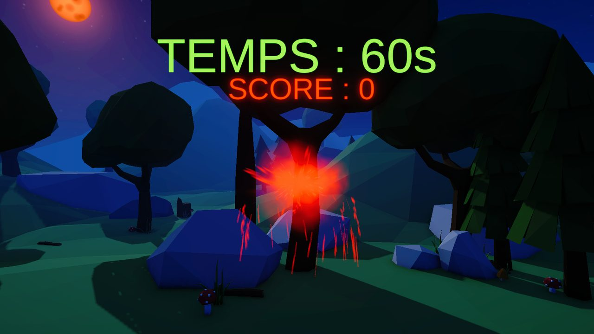
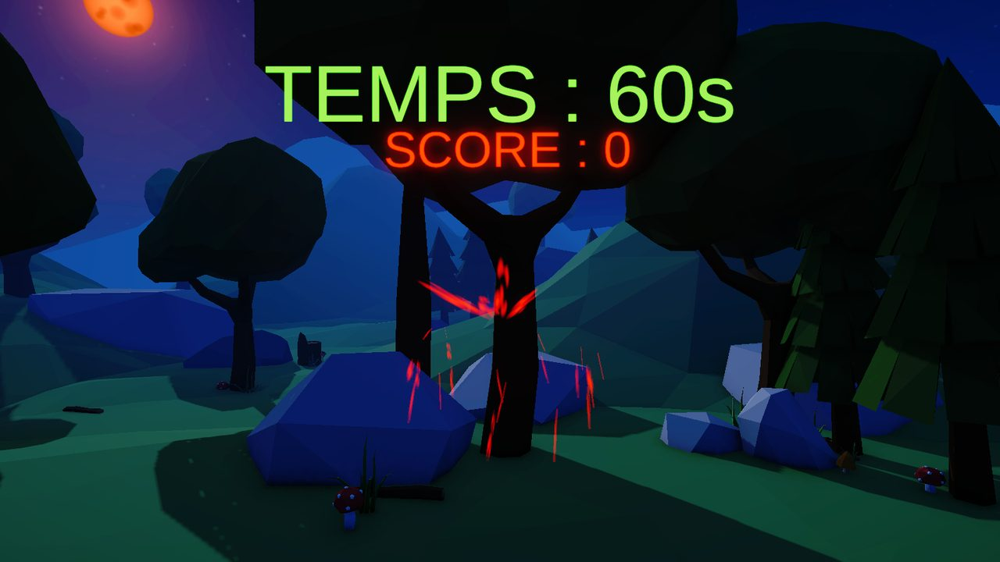
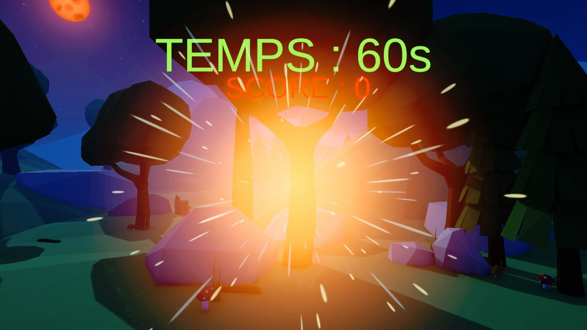
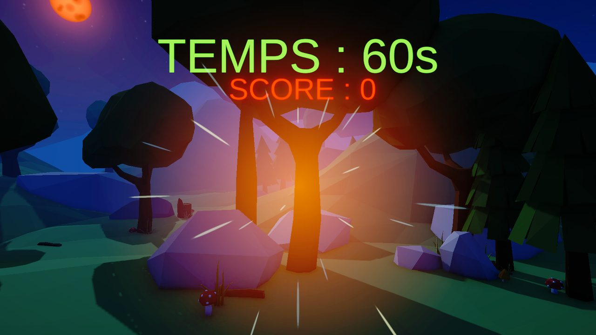

# 5. Effets multiplateforme (PCVR et Quest)

> **En bref** : chaque effet de particules existe en **deux prefabs**, une version **PCVR** complète et une version **Quest** allégée. Le jeu choisit automatiquement la bonne **au moment de la compilation**, selon la plateforme du build.

[← Rendu et shaders](04-rendu-et-shaders.md) · [README](../README.md) · Suivant : [Audio →](06-audio.md)

---

## Sommaire

- [Pourquoi deux versions ?](#pourquoi-deux-versions-)
- [Ce qui change entre les deux](#ce-qui-change-entre-les-deux)
- [Comment le bon effet est choisi](#comment-le-bon-effet-est-choisi)
- [Le shader des particules](#le-shader-des-particules)
- [Faire la même chose pour un nouvel effet](#faire-la-même-chose-pour-un-nouvel-effet)
- [Ce qu'il reste à mesurer](#ce-quil-reste-à-mesurer)

---

## Pourquoi deux versions ?

| | PC VR | Quest autonome |
|---|---|---|
| Qui calcule l'image ? | la carte graphique du PC (ici une RTX 3080) | la puce mobile du casque |
| Budget par image (90 Hz) | large | environ **11 ms**, pour chaque œil |

Sur Quest, ce qui coûte le plus avec les particules, ce n'est pas leur **nombre** en soi, c'est le **remplissage**. Chaque particule est un carré transparent ; quand plusieurs grandes particules se superposent devant la caméra, le GPU calcule **les mêmes pixels plusieurs fois**. C'est l'*overdraw*, et les GPU mobiles y sont très sensibles.

> [!TIP]
> **À retenir** : pour alléger un effet sur mobile, on retire d'abord les **grandes particules transparentes qui couvrent l'écran** (halos, brumes), avant de compter les petites étincelles.

---

## Ce qui change entre les deux

<table>
<tr><th></th><th>PCVR</th><th>Quest</th></tr>
<tr><td><b>Jus</b></td>
<td></td>
<td></td></tr>
<tr><td><b>Explosion</b></td>
<td></td>
<td></td></tr>
</table>

| Paramètre | Jus PCVR | Jus Quest | Explosion PCVR | Explosion Quest |
|---|---|---|---|---|
| Couches (Particle Systems) | 5 | 3 | 9 | 4 |
| Particules max simultanées | 134 | 27 | 106 | 22 |
| Nombre de particules par burst | d'origine | ×0,4 | d'origine | ×0,4 |
| Durée de vie | d'origine | ×0,7 | d'origine | ×0,7 |
| Module Noise | oui | non | non | non |
| Lumière dynamique (flash) | non | non | oui | non |
| Collisions de particules | non | non | non | non |
| Textures sur Android | – | 256 px max, ASTC 6×6 | – | 256 px max, ASTC 6×6 |

Pourquoi chaque réduction :

| Réduction | Raison |
|---|---|
| Moins de couches | on retire surtout les halos et brumes, la cause principale de l'overdraw |
| Bursts ×0,4, durée de vie ×0,7 | moins de particules vivantes en même temps |
| Pas de module Noise | il recalcule la trajectoire de chaque particule à chaque image (calcul CPU) |
| Pas de lumière dynamique | une lumière temps réel en plus coûte cher sur mobile ; le flash visuel suffit |
| Textures 256 px en ASTC | moins de mémoire et de bande passante (ASTC est le format compressé natif du Quest) |
| Pas de collisions | inutiles pour un effet de 0,5 s, et coûteuses |

Le plus important est que l'effet reste **lisible** : on voit toujours l'éclaboussure à la couleur du fruit et le flash orange de la bombe.

---

## Comment le bon effet est choisi

Le sabre (`SwordSlicer`) a deux emplacements par effet :

```csharp
public GameObject fruitJuiceFXPrefab;       // version PCVR
public GameObject fruitJuiceFXPrefabQuest;  // version Quest
```

Au moment de la coupe, il demande à `PlatformFx` lequel utiliser :

```csharp
public static class PlatformFx
{
#if UNITY_ANDROID
    public const bool IsQuest = true;
#else
    public const bool IsQuest = false;
#endif

    public static GameObject Pick(GameObject pcvr, GameObject quest)
    {
        if (IsQuest && quest != null) return quest;
        return pcvr != null ? pcvr : quest;   // repli : jamais d'effet manquant
    }
}
```

- `UNITY_ANDROID` est un **symbole de compilation** défini par Unity quand la cible est Android. Le choix est donc fait **une fois, à la compilation** : aucun test au lancement, aucun coût.
- **Dans l'éditeur aussi** : passer la cible de build sur Android affiche directement les effets Quest, ce qui est pratique pour comparer.
- **Repli** : s'il manque la version Quest, on prend la version PC plutôt que de ne rien afficher.
- **Contrôle** : au lancement, chaque sabre écrit dans le log la variante utilisée (`[FX] … variante Quest`).

> [!NOTE]
> Le même `PlatformFx.IsQuest` sert ailleurs : décor par défaut (`Parametres.HighPoly`).

---

## Le shader des particules

Les effets d'origine (pack **Vefects**) utilisaient des shaders du pipeline *Built-in*, qui s'affichent **en rose** en URP. Plutôt que d'ajouter un pack de conversion, un shader léger a été écrit : `FruitNinja/ParticleMask`.

```hlsl
half mask = saturate(dot(tex, _Channel));   // un canal de la texture sert de masque
half4 col = i.color * _Tint;                // couleur de la particule × teinte
half a = saturate(col.a * mask);
// prémultiplié : additif (Blend One One) ou transparent (Blend One OneMinusSrcAlpha)
```

Il est commun aux deux versions, compatible Single Pass Instanced, et ne fait qu'une lecture de texture par pixel.

---

## Faire la même chose pour un nouvel effet

1. **Dupliquer** le prefab de l'effet et l'appeler `…_Quest`.
2. Dans la copie, **retirer** les couches les plus grandes et les plus transparentes, puis **réduire** les bursts, la durée de vie et le nombre maximal de particules.
3. **Couper** le module Noise, les lumières et les collisions.
4. Sur les textures utilisées, régler la **taille max et le format pour Android** (onglet de la plateforme dans l'import).
5. Ajouter les **deux emplacements** dans le script qui déclenche l'effet, et instancier via `PlatformFx.Pick(pcvr, quest)`.
6. **Mesurer dans le casque** (voir ci-dessous).

---

## Ce qu'il reste à mesurer

L'allègement a été fait **par principe**, à partir des causes connues de lenteur sur mobile. Il reste à le **prouver par la mesure** :

- lancer le jeu sur Quest avec l'**OVR Metrics Tool** (FPS, temps GPU) ;
- couper plusieurs fruits et une bombe d'affilée pour obtenir le **pire cas** ;
- comparer avec les effets PCVR forcés sur Quest.

C'est cette mesure qui dira si l'allègement était **nécessaire et suffisant**. Elle fait aussi le lien entre la Task 3 (effets) et la Task 4 (tests) du TP.

---

[← Rendu et shaders](04-rendu-et-shaders.md) · [README](../README.md) · Suivant : [Audio →](06-audio.md)
