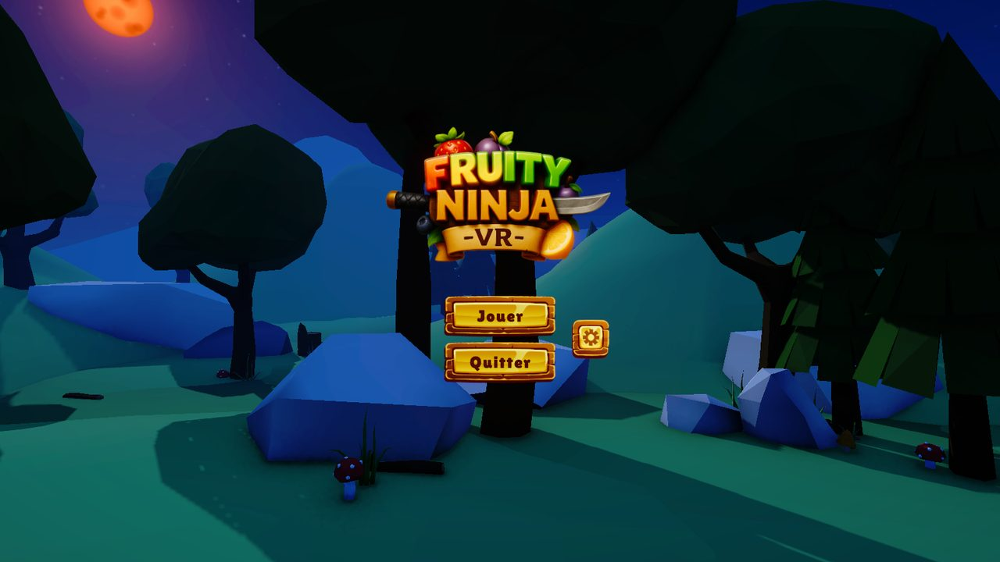
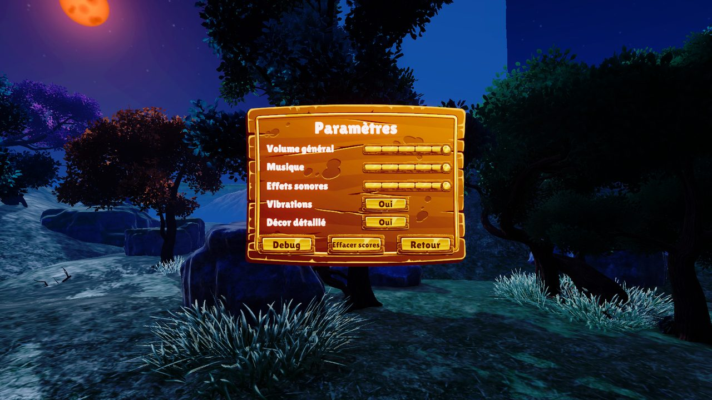
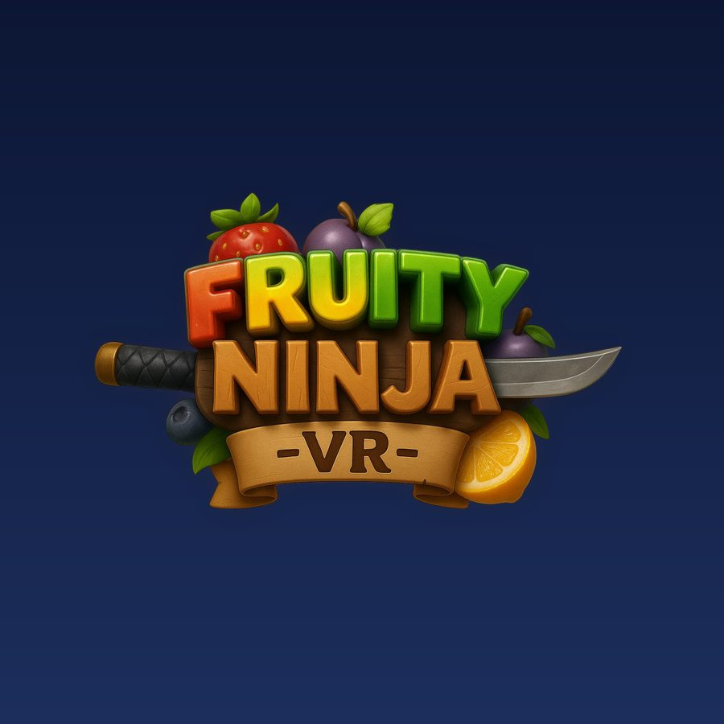
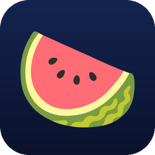

# 7. Interface

> **En bref** : une interface en **bois et or** accordée au logo, une police cartoon unique (**Lilita One**), des menus cliquables au rayon, un panneau **Paramètres**, un **classement**, un **écran de démarrage** et une **icône** personnalisés.

[← Audio](06-audio.md) · [README](../README.md) · Suivant : [Builds et déploiement →](08-builds-et-deploiement.md)

---

## Sommaire

- [Une direction artistique cohérente](#une-direction-artistique-cohérente)
- [Le menu principal](#le-menu-principal)
- [Le menu Paramètres](#le-menu-paramètres)
- [Les textes dans le décor](#les-textes-dans-le-décor)
- [Écran de démarrage et icône](#écran-de-démarrage-et-icône)
- [Préparer des éléments d'UI à partir d'une planche JPG](#préparer-des-éléments-dui-à-partir-dune-planche-jpg)

---

## Une direction artistique cohérente

Tout part du **logo** (« Fruity Ninja VR », généré par IA) : lettres épaisses, bois chaud, or, contours bruns. Le reste de l'interface a été **accordé** à ce logo :

| Élément | Choix | Pour s'accorder au logo |
|---|---|---|
| Boutons, planches | pack d'UI en bois et or | même matière ; saturation, contraste et teinte **mesurés sur le logo** puis appliqués aux images |
| Police | **Lilita One** (licence OFL) | lettres épaisses, arrondies, un peu condensées, comme « FRUITY NINJA » |
| Contours de texte | brun foncé | comme le contour des lettres du logo |

---

## Le menu principal



Un canvas en espace monde, à environ 3 m du joueur : le logo, **Jouer**, **Quitter** et un bouton **engrenage** pour les Paramètres. Les clics se font au rayon des manettes (voir [VR et interactions](03-vr-et-interactions.md#rayons-dans-les-menus-sabres-en-jeu)).

---

## Le menu Paramètres



| Ligne | Contrôle | Effet |
|---|---|---|
| Volume général | curseur | tout le son |
| Musique | curseur | musiques et ambiance |
| Effets sonores | curseur | effets 3D et sabres |
| Vibrations | Oui / Non | active ou coupe les vibrations ; une petite vibration confirme le « Oui » |
| Décor détaillé | Oui / Non | décor **High poly** (ToonScapes) ou **Low poly** ; recharge le menu dans le décor choisi et rouvre le panneau |
| Rotation | Instantanée / Continue | type de rotation au joystick (voir [VR et interactions](03-vr-et-interactions.md#rotation-et-zone-de-jeu)) |
| Debug | bouton | ouvre la scène `Debug_Fruits` (tous les fruits exposés), qui a son propre bouton Retour |
| Effacer scores | bouton | vide le classement |
| Retour | bouton | revient à l'accueil |

### Comment marche un curseur en bois ?

Un `Slider` Unity standard, habillé avec trois images du pack :

```text
Curseur_Musique (Slider + ReglageVolume)
├── Fond            Barre_Vide       (la barre vide)
├── Remplissage     Barre_Pleine     (Image en mode Filled horizontal : fillAmount = valeur)
└── Zone_Poignee
    └── Poignee     Poignee_Ronde    (déplacée par le Slider)
```

Le `Slider` gère le glisser au rayon ; `ReglageVolume` met à jour le remplissage et enregistre la valeur dans `Parametres`.

> [!TIP]
> Utiliser une image en mode **Filled** pour le remplissage, plutôt que le `fillRect` du Slider qui étire l'image, garde les segments dorés de la barre **intacts** : ils se dévoilent au lieu de se déformer.

---

## Les textes dans le décor

| Texte | Où | Particularité |
|---|---|---|
| Étiquettes FACILE / NORMAL / HARDCORE / RETOUR | au-dessus des fruits du menu | masquées pendant la partie ; durée affichée à côté du choix |
| Score, Temps, Meilleur score | HUD dans le décor | — |
| « Prêt ? » | devant le joueur au départ | — |
| « −3 » | au-dessus d'une bombe touchée | créé par code (`PenaltyPopup`), monte et s'efface, tourné vers le joueur |
| Classement | planche en bois à droite | dessiné **après** le HUD pour ne jamais être recouvert |

Tous utilisent **Lilita One**, définie aussi comme **police par défaut de TextMeshPro** : un texte créé par code l'utilise automatiquement.

> [!NOTE]
> **Pourquoi le classement passait sous « Meilleur score » ?** Les interfaces transparentes n'écrivent pas dans le tampon de profondeur : c'est l'**ordre de dessin** qui décide de ce qui est devant, pas la position en 3D. Donner au canvas du classement un `sortingOrder` plus élevé le fait dessiner après le HUD.

---

## Écran de démarrage et icône

 

| Élément | Réglage |
|---|---|
| Écran de démarrage Unity | logo du jeu sur fond bleu nuit, **sans le logo Unity** (possible avec Unity 6) |
| Écran de démarrage en VR | `virtualRealitySplashScreen` = la même image |
| Écran de démarrage système du Quest | fonctionnalité Meta Quest d'OpenXR → `systemSplashScreen` (affiché par le casque pendant le chargement) |
| Icône de l'application | émoji pastèque de Noto Emoji sur fond nuit arrondi, pour PC et Android |

---

## Préparer des éléments d'UI à partir d'une planche JPG

Les éléments en bois venaient d'une **planche JPG sur fond blanc**. Les découper « à la main » laisse un **liseré blanc** autour de chaque élément, visible dès que l'image est filtrée (de loin, en VR). Le traitement appliqué, par script Python :

1. **Détourage** : le blanc relié au bord de l'image devient transparent ; l'anneau de bord reçoit une transparence progressive.
2. **Décontamination** : on retire mathématiquement le blanc mélangé dans les pixels de bord (`c = (c_observée − (1 − a) × blanc) / a`).
3. **Dilatation** : les pixels transparents prennent la couleur du bord le plus proche, pour que le filtrage mélange du brun avec du brun, et non avec du blanc.
4. **Retouche couleur** identique pour tous les éléments (teinte, saturation et contraste du logo, contour sombre réchauffé).
5. Import en **sprite** avec mipmaps, filtrage trilinéaire et anisotrope.

> [!TIP]
> **À retenir** : un pixel transparent a quand même une couleur, et le filtrage la mélange avec ses voisins. Une image détourée doit avoir des pixels transparents de la **bonne couleur**, pas blancs.

---

[← Audio](06-audio.md) · [README](../README.md) · Suivant : [Builds et déploiement →](08-builds-et-deploiement.md)
