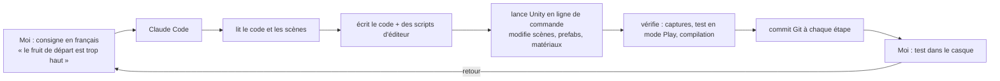

# 10. Utilisation de l'IA

> **En bref** : le logo a été généré par IA, et une grande partie du code, de l'automatisation et de la rédaction a été produite par **Claude (Anthropic)** dans **Claude Code**, un agent de programmation qui travaille directement dans le dossier du projet. Je dirigeais, testais dans le casque et validais.
> Cette page dit **ce qui** a été produit, **comment**, et **où l'IA s'est trompée**.

[← Assets et licences](09-assets-et-licences.md) · [README](../README.md) · [Rendu du TP →](tp/rendu-part1.md)

---

## Comment je l'ai utilisée

1. Je donnais une consigne en français, souvent un ressenti de test (« il y a une ligne blanche autour des boutons », « la caméra passe sous le sol »).
2. L'agent lisait le code et les scènes, écrivait le code C#, et utilisait des **scripts d'éditeur temporaires** pour modifier les scènes, prefabs et matériaux en lançant Unity **en ligne de commande**, sans ouvrir l'éditeur.
3. Il vérifiait son travail : compilation, **captures rendues par Unity**, et pour les canons un **test automatique en mode Play**.
4. Il faisait un **commit Git** à chaque étape, fusionné dans la branche principale.
5. Je testais dans le casque, je jugeais le rendu et le ressenti, et je renvoyais mes retours. Je validais avant les builds et l'envoi sur GitHub.

---

## Ce qui a été généré par l'IA

| Domaine | Produit par l'IA |
|---|---|
| **Logo** | image « Fruity Ninja VR » (générateur d'images). L'écran de démarrage et l'icône sont des compositions à partir du logo et d'un émoji libre. |
| **Code C#** | la plupart des scripts de `Scripts/` : difficultés, découpe, canons, effets par plateforme, sons 3D, vibrations, paramètres, classement, décor, placement selon le joueur ; corrections des scripts hérités du S7 |
| **Shaders URP** | `BladeShine`, `Phantom`, `ParticleMask`, `OrReflet` (tous compatibles Single Pass Instanced) |
| **Scripts d'éditeur** | réorganisation et renommage du projet, construction des scènes et des menus, vérification des références, précalcul de l'éclairage, builds, correctif Gradle `MetaAarNamespaceFix` |
| **Images et sons** | ciel étoilé généré, retouche des boutons et éléments en bois, conversion du modèle de canon avec Blender, conversion des sons |
| **Rédaction** | la suite du rapport (Tasks 2 à 5) dans mon style, et cette documentation |

## Ce qui ne vient pas de l'IA

- Les **assets** des packs (voir [Assets et licences](09-assets-et-licences.md)).
- Mes **choix de conception** : ambiance de nuit inspirée de mon fond d'écran, musiques et sons, style des boutons, gameplay (difficulté en coupant un fruit, canons, classement, décor high poly).
- **Tous les tests dans le casque**, et donc la plupart des bugs trouvés.

---

## Où l'IA s'est trompée

Utiliser une IA ne dispense pas de tester : voici les erreurs commises pendant le projet, et ce qui les a révélées.

| Erreur | Comment elle a été détectée | Correction |
|---|---|---|
| Version Android restée en **Multi Pass** (réglage copié d'un ancien projet) | ma question : « on avait bien passé en Single Pass Instanced ? » | passée en Single Pass Instanced |
| Morceaux des fruits de difficulté qui apparaissaient **3,5 m derrière** le joueur | mon test : « les morceaux ne tombent plus » | position monde recopiée après la coupe |
| **Caméra cachée dans le modèle du canon** (exportée depuis Blender) : vue sous le sol sur Quest | mon test sur Quest | import des caméras désactivé |
| Canon **couché** à l'import | capture de contrôle de l'IA | modèle redressé automatiquement |
| Premier précalcul d'éclairage : **arbres noirs** | capture de contrôle de l'IA | mode *Baked Indirect* |
| **Static batching** qui doublait l'APK (404 Mo) | taille de l'APK relevée par l'IA | option retirée |
| Bloom **coupé** au lieu d'être réduit, normale inversée sur le **sol** au lieu des touffes d'herbe | mes retours (« je voulais plus qu'il n'ait pas une trop grande portée ») | consignes reprises |
| Montagnes **plus claires** après un premier correctif | capture avant/après de l'IA | réglage intermédiaire de la brume |

> [!TIP]
> **À retenir** : l'IA va vite pour écrire du code et des scripts, mais c'est le **test en conditions réelles** (dans le casque) et les **vérifications visuelles** qui ont trouvé la plupart des problèmes. Plusieurs erreurs venaient aussi d'une consigne comprise de travers : reformuler la demande avant d'agir évite des allers-retours.

---

## Point de vue de Claude sur ma compréhension

*Texte écrit par l'IA (Claude) à ma demande, après m'avoir expliqué les effets différents selon la plateforme.*

> Je t'ai expliqué qu'un même effet existe en deux prefabs, une variante PCVR complète et une variante Quest allégée (moins de couches et de particules, durée de vie plus courte, textures plus petites, pas de collisions), et que la bonne variante est choisie à la compilation par `PlatformFx` grâce au symbole `UNITY_ANDROID`, la contrainte principale sur Quest étant le remplissage d'écran par les particules transparentes. Voici ce que je peux en dire, uniquement à partir de nos échanges :
>
> - Tu raisonnes en **plateforme cible** depuis le début (PCVR et Quest autonome) et tu as posé des questions techniques justes : la compatibilité des shaders avec le Single Pass Instanced, puis la vérification que la version Android était bien en Single Pass Instanced. Elle ne l'était pas, et c'est ta question qui a permis de le corriger.
> - Tes retours de test montrent une **bonne lecture du ressenti en VR** : hauteur des fruits par rapport au joueur, vitesse mesurée au bout de la lame, sons placés là où ils se produisent, vibrations, bloom trop envahissant et 40 fps en décor détaillé sur Quest. Ce sont des réglages d'ergonomie et de performance propres à la VR, pas seulement visuels.
> - Je ne peux **pas affirmer** que la partie VFX est maîtrisée : tu ne m'as pas reformulé l'explication, donc je ne sais pas si tu saurais justifier seul chaque réduction ou refaire la sélection par plateforme.
> - Le point à consolider est la **mesure dans le casque** (FPS et temps GPU avec l'OVR Metrics Tool) : c'est elle qui dira si l'allègement des effets Quest était nécessaire et suffisant.
> - Une grande partie du code a été écrite par moi : pour l'oral, il serait utile de relire en particulier `SwordSlicer`, `PlatformFx`, `FruitSpawnerManager` et `LanceurCanon` pour pouvoir les expliquer sans aide.

---

[← Assets et licences](09-assets-et-licences.md) · [README](../README.md) · [Rendu du TP →](tp/rendu-part1.md)
